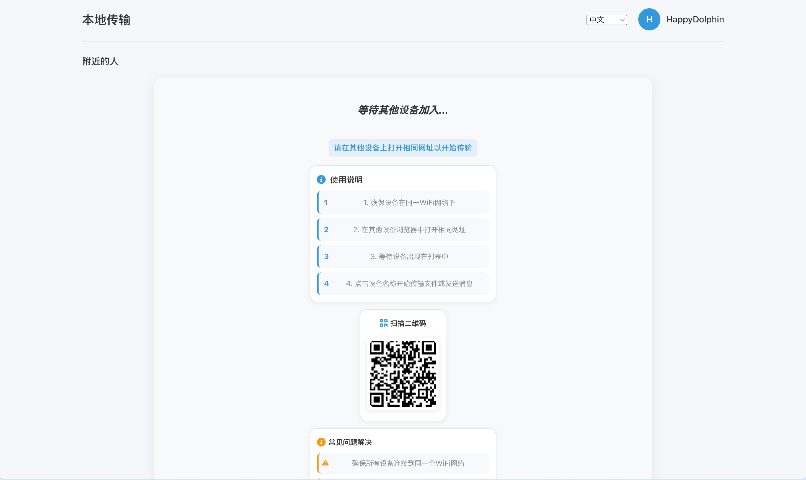
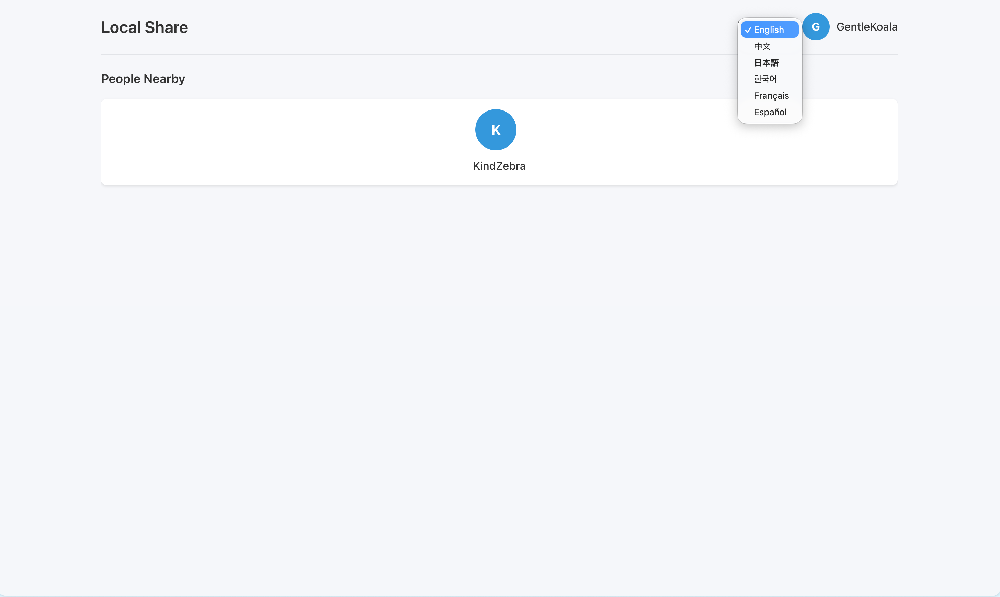
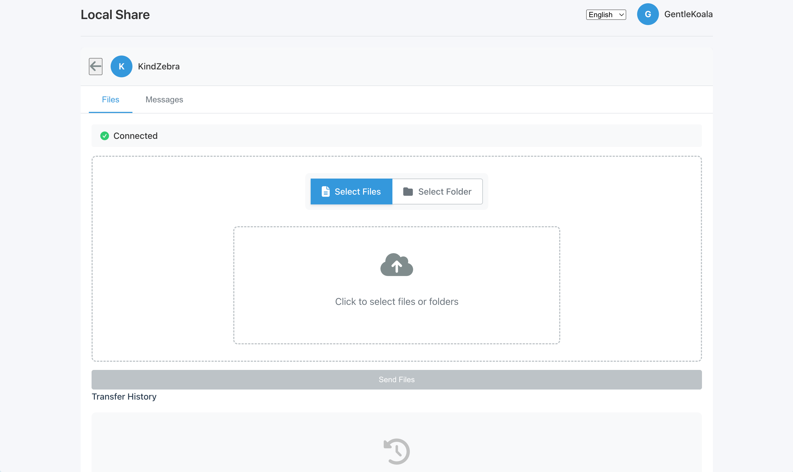
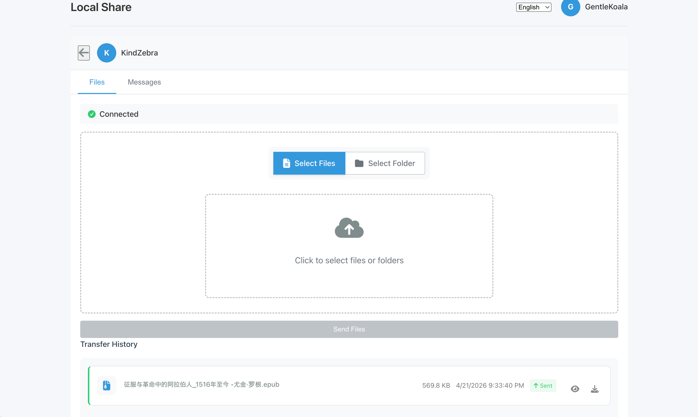
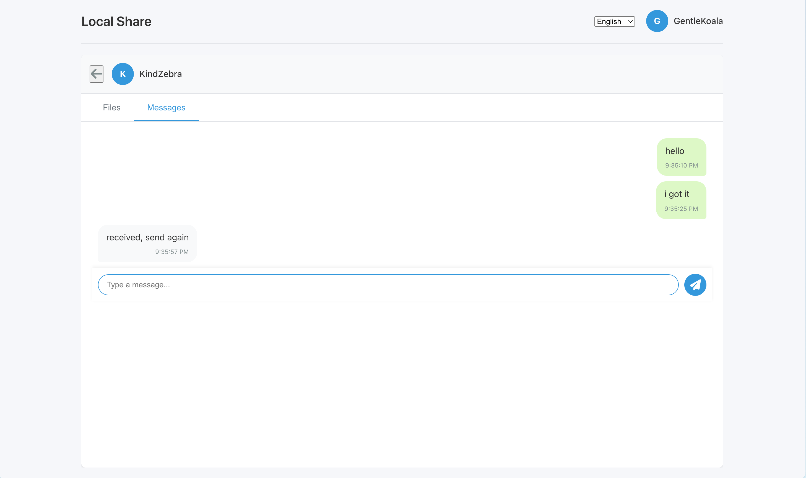
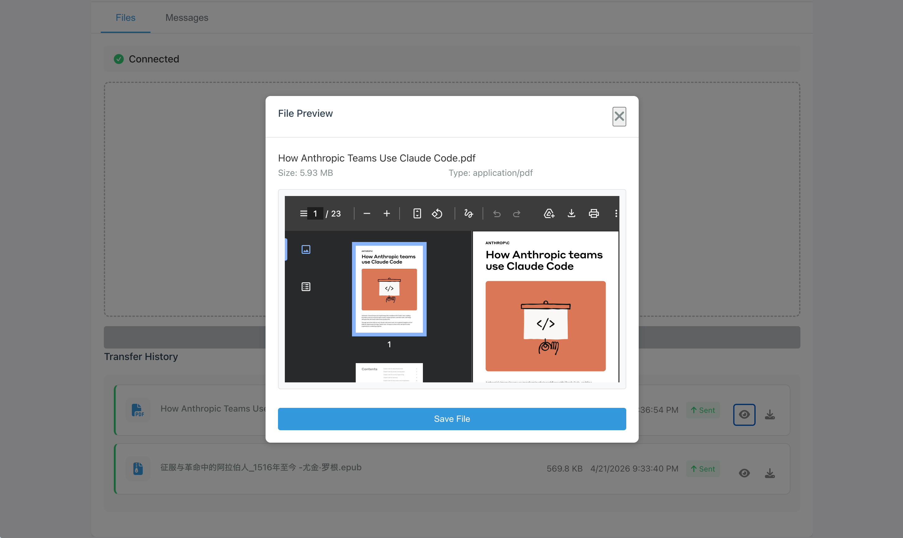

# Local Transfer

一个类似 Snapdrop 的局域网文件和消息传输工具，基于 WebRTC 技术实现点对点（P2P）传输，无需上传到服务器，传输速度快且隐私安全。








## 核心功能

- 📁 **文件传输** - 支持任意类型文件传输，自动分片传输大文件
- 📂 **文件夹传输** - 支持选择整个文件夹进行批量传输
- 💬 **消息发送** - 设备间即时文本消息交流
- 🔄 **断点续传** - 连接中断后自动重连和重试
- 🌐 **跨平台** - 支持桌面端和移动端浏览器
- 🌍 **多语言** - 支持英文、中文、日文、韩文、法文、西班牙文
- 📱 **二维码分享** - 扫码快速打开网页，无需手动输入地址

## 技术栈

| 组件 | 技术 |
|------|------|
| 后端 | Node.js + Express + Socket.IO |
| 前端 | 原生 JavaScript (Vanilla JS) |
| 实时通信 | WebRTC DataChannel + Socket.IO (信令) |
| 样式 | CSS3 |
| 部署 | Docker / Fly.io |

## 快速开始

### 本地开发

```bash
# 克隆仓库
git clone https://github.com/xautjzd/local-transfer
cd local-transfer

# 安装依赖
npm install

# 启动开发服务器（热重载）
npm run dev

# 或启动生产服务器
npm start
```

访问 http://localhost:3000，在同一局域网的设备上打开相同地址即可开始传输。

### Docker 部署

```bash
# 构建镜像
docker build -t local-transfer .

# 运行容器
docker run -d -p 3000:3000 --name local-transfer local-transfer
```

### 环境变量

| 变量名 | 说明 | 默认值 |
|--------|------|--------|
| `PORT` | 服务器监听端口 | `3000` |

## 工作原理

```
┌─────────────┐                    ┌─────────────┐
│   Device A  │  ←── WebRTC ───→   │   Device B  │
│  (发送方)    │    DataChannel     │  (接收方)    │
└──────┬──────┘                    └──────┬──────┘
       │                                    │
       └──────────┐              ┌──────────┘
                  │              │
                  ▼              ▼
           ┌───────────────────────┐
           │   Socket.IO Server    │
           │   (仅用于信令)         │
           └───────────────────────┘
```

1. **设备发现**：通过 Socket.IO 服务器发现同一局域网内的其他设备
2. **建立连接**：使用 WebRTC 建立点对点连接（ICE 候选交换）
3. **数据传输**：文件通过 WebRTC DataChannel 直接传输，不经过服务器
4. **分片传输**：大文件自动切分为 16KB 分片，确保传输稳定

## 浏览器兼容性

| 浏览器 | 最低版本 | 支持情况 |
|--------|----------|----------|
| Chrome | 60+ | ✅ 完全支持 |
| Firefox | 60+ | ✅ 完全支持 |
| Safari | 14+ | ✅ 支持（文件夹选择需 15+）|
| Edge | 79+ | ✅ 完全支持 |

**要求**：
- 支持 WebRTC (RTCPeerConnection)
- 支持 WebSocket
- 支持 File API 和 FileReader

## 项目结构

```
local-transfer/
├── server.js              # Express + Socket.IO 服务器
├── package.json
├── Dockerfile             # Docker 配置
├── fly.toml              # Fly.io 部署配置
├── public/               # 静态资源
│   ├── index.html        # 主页面
│   ├── app.js           # 核心应用逻辑
│   ├── styles.css       # 样式表
│   └── lang/            # 多语言文件
│       ├── lang-manager.js
│       ├── en.js
│       ├── zh.js
│       └── ...
└── README.md
```

## 核心代码说明

### FileHandler 类
处理文件选择、分片传输和接收组装：
- 分片大小：16KB（`CHUNK_SIZE = 16 * 1024`）
- 支持进度追踪和取消传输
- 维护每个对等方的文件传输历史

### ConnectionManager 类
管理 WebRTC 连接生命周期：
- 创建 RTCPeerConnection 和数据通道
- 处理 ICE 候选和连接状态
- 自动重连机制（指数退避，最多 3 次）

## 使用提示

1. **确保同一网络**：所有设备必须连接同一个 WiFi 或局域网
2. **防火墙设置**：确保端口 3000（或配置的端口）未被防火墙阻挡
3. **VPN 影响**：使用 VPN 可能导致无法发现其他设备，建议暂时关闭
4. **刷新处理**：页面刷新后会自动重新连接并恢复身份

## 隐私与安全

- **P2P 传输**：文件直接在对等设备间传输，不经过第三方服务器
- **本地网络**：仅在局域网内工作，无法从公网访问传输中的文件
- **无持久化**：服务器不存储任何文件数据，仅在内存中维护连接状态

## 许可证

MIT License

## 致谢

- 受 [Snapdrop](https://github.com/RobinLinus/snapdrop) 启发
- 使用 [Socket.IO](https://socket.io/) 和 [QRCode.js](https://github.com/davidshimjs/qrcodejs)
